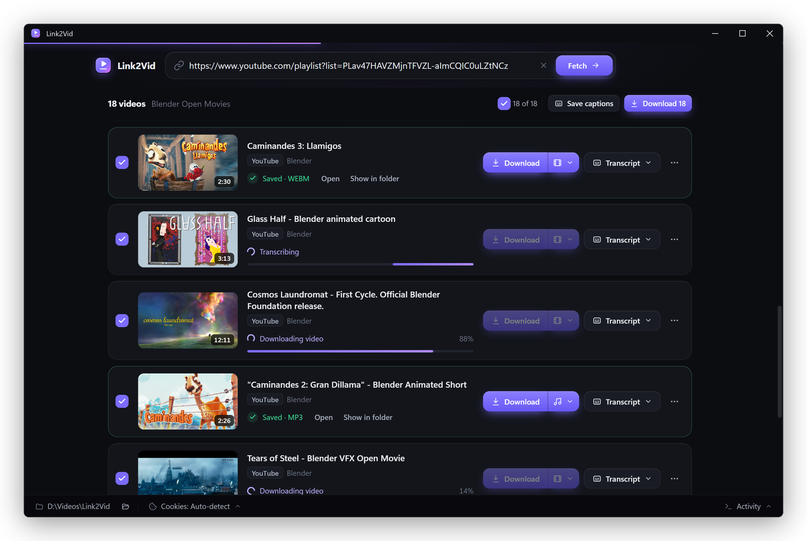
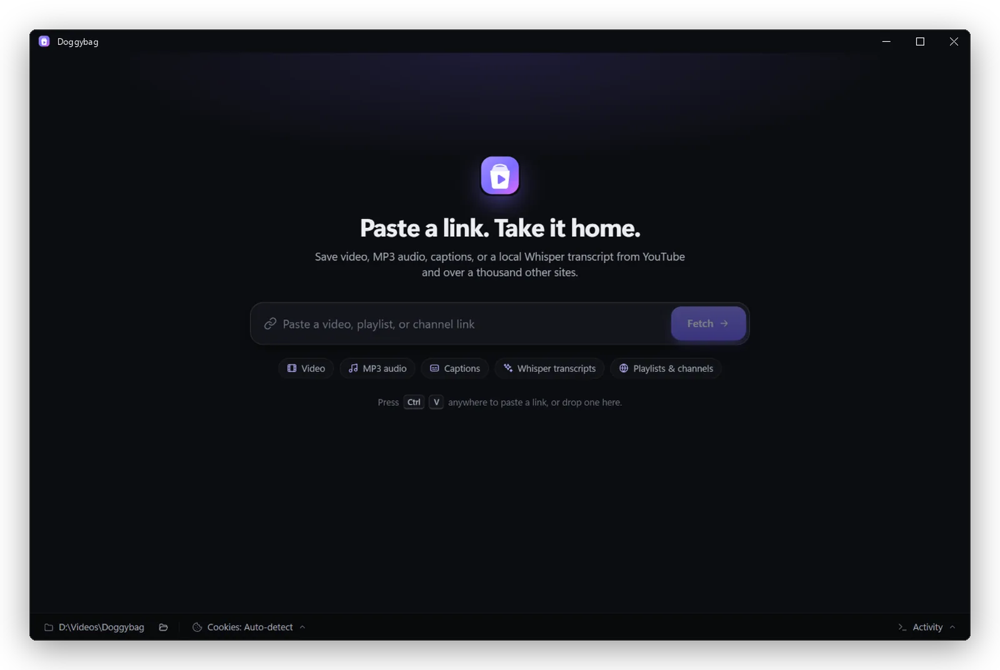
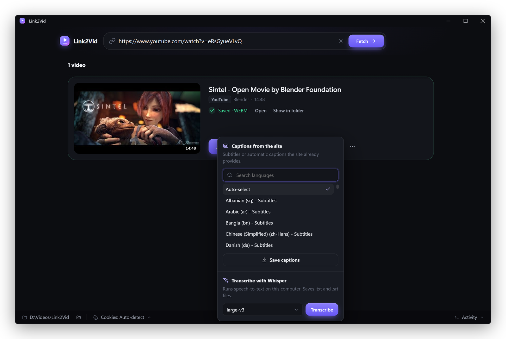
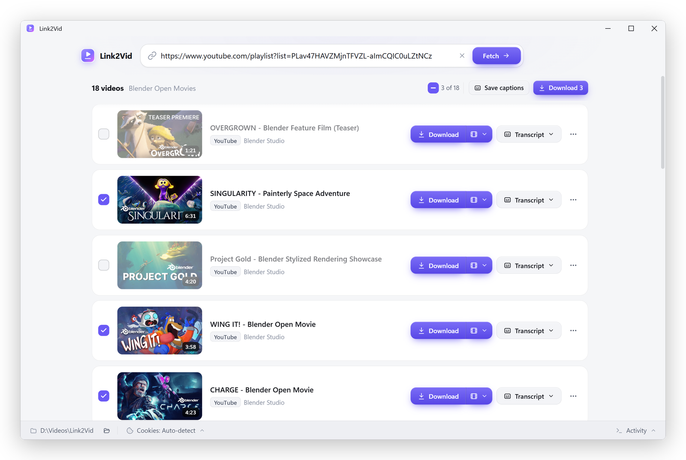
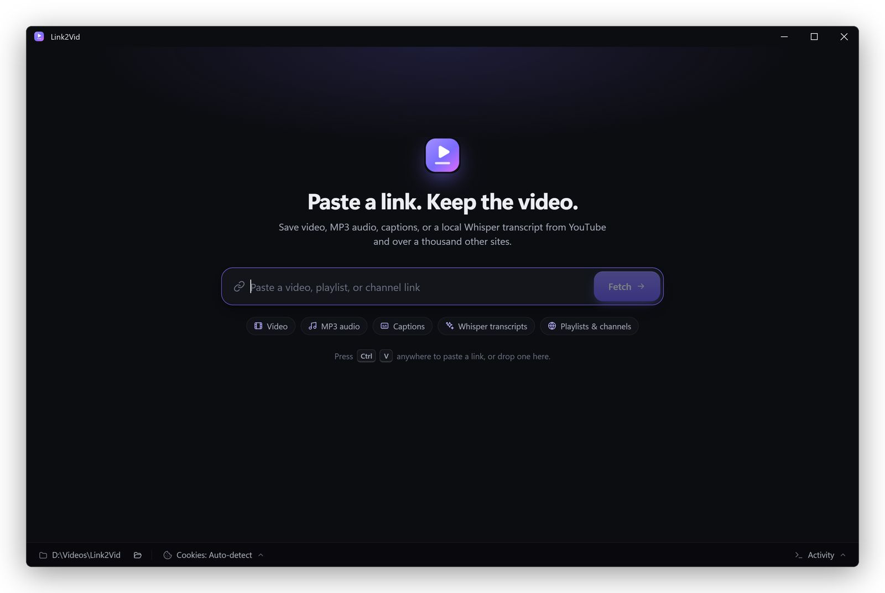
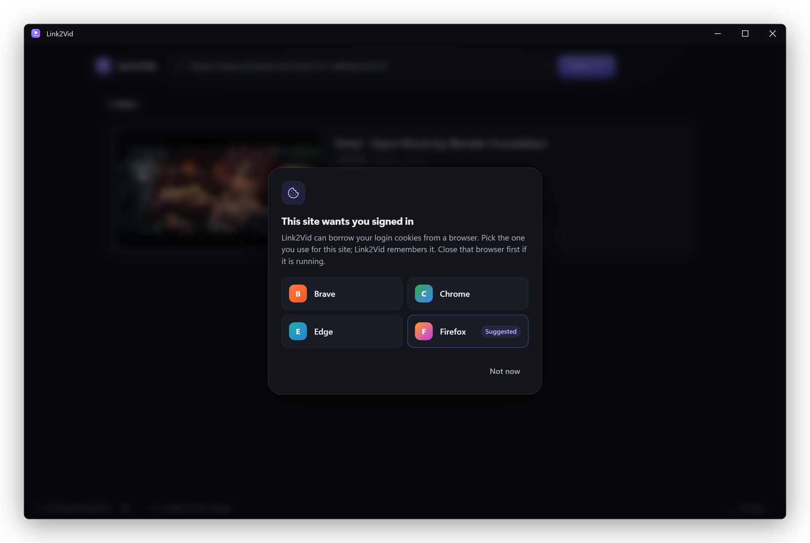

<p align="center">
  
</p>

<h1 align="center">Link2Vid</h1>

<p align="center">
  <strong>Paste a link. Keep the video.</strong><br>
  A fast, good-looking desktop app for saving video, MP3 audio, captions, and local AI transcripts<br>
  from YouTube and the 1,000+ other sites <a href="https://github.com/yt-dlp/yt-dlp">yt-dlp</a> supports.
</p>

<p align="center">
  
  
  
  
  <a href="LICENSE.md"></a>
</p>

<p align="center">
  
</p>

---

## Why Link2Vid

yt-dlp is the best downloader there is, and it runs in a terminal. Link2Vid puts a calm, modern window around it, so you can paste a link and click once instead of memorizing format flags.

- **One click, the right file.** Pick **Video**, **Video only**, or **Audio (MP3)** per item, then **Download**. When it's done, **Open** it or **Show in folder** straight from the card.
- **Whole playlists and channels.** Every item starts selected. Untick what you don't want, then **Download 18** grabs the rest one by one, each in its own format.
- **Captions in any language.** Save the subtitles the site already has, with a searchable language list. Real subtitle tracks are listed before machine translations.
- **Transcripts that never leave your PC.** Run [Faster Whisper](https://github.com/SYSTRAN/faster-whisper) locally (GPU if you have one, CPU if not) to get `.txt` and `.srt` files for anything with speech, even when the site has no captions.
- **Works when sites push back.** Sign-in walls, cookie prompts, HLS streams, embedded players: Link2Vid tries the simple path first and only asks you for a browser or credentials when a site actually needs them.
- **Feels like a real app.** Light and dark mode that follow Windows, live progress, `Ctrl+V` anywhere to paste, drag-and-drop links, and an Activity log with one-click diagnostics when something goes wrong.

## See it in action

<p align="center">
  
</p>

## A closer look

<table>
  <tr>
    <td width="50%" valign="top">
      
      <p><strong>Captions or Whisper, per video.</strong> Choose a caption language from the site, or transcribe locally with the Whisper model of your choice.</p>
    </td>
    <td width="50%" valign="top">
      
      <p><strong>Playlists, your way.</strong> Pick exactly the items you want. Light mode follows your Windows setting.</p>
    </td>
  </tr>
  <tr>
    <td width="50%" valign="top">
      
      <p><strong>Start with a link.</strong> Paste it, drop it on the window, or let Link2Vid offer the link already on your clipboard.</p>
    </td>
    <td width="50%" valign="top">
      
      <p><strong>Sign-in when a site needs it.</strong> Borrow cookies from the browser you already use, or point it at a <code>cookies.txt</code>.</p>
    </td>
  </tr>
</table>

## Get started

You need **Windows 10 or 11** and **Python 3.10+**. The Edge WebView2 runtime that draws the window ships with Windows 11 and current Windows 10.

```bash
git clone https://github.com/insominx/Link2Vid.git
cd Link2Vid
setup_link2vid.bat        # installs Python dependencies, checks for ffmpeg and a JS runtime
run_link2vid.bat          # launches the app
```

Optional, but recommended:

- **[ffmpeg](https://ffmpeg.org/download.html)** on your `PATH`. It merges best-quality video with audio and makes MP3s.
- **A JavaScript runtime** ([Deno](https://deno.com/), Node, or Bun). Some YouTube formats need one to solve player challenges.
- A `.venv` (`python -m venv .venv`) before running setup. The scripts pick it up automatically.

### Build a portable app

```bash
build_windows.bat
```

This produces a self-contained folder at `release\Link2Vid\`, with ffmpeg bundled if it's on your `PATH`. Start it with `Link2Vid.bat` or `Link2Vid.exe`, pin it to the taskbar, or zip the folder to move it to another PC. See [docs/windows-packaging.md](docs/windows-packaging.md) for details.

## Using it

1. **Paste a link** into the box (or press `Ctrl+V` anywhere in the window) and press **Fetch**.
2. **Choose a format** with the chevron next to **Download**: Video, Video only, or Audio (MP3).
3. **Download.** The card shows live progress and then **Open** / **Show in folder**. If something fails, use **Retry**, or **Details** to see the log.
4. **Transcript** opens a panel where you can save the site's captions or transcribe locally with Whisper.
5. **Playlists:** use the checkboxes, then **Download N** or **Save captions** in the header. Batches run one item at a time, and **Stop** finishes the current item and skips the rest.

The bottom bar holds your **download folder** (click to change it) and the **Cookies** source. A site that wants you signed in can borrow cookies from Brave, Chrome, Edge, or Firefox, or from a `cookies.txt` export.

| Shortcut | Action |
|---|---|
| `Ctrl+V` (outside a text box) | Paste a link and fetch it |
| `Ctrl+L` / `Ctrl+K` | Jump to the link box |
| `Ctrl+J` | Show or hide the Activity log |
| `Esc` | Close a menu, dialog, or the Activity log |

## Local Whisper transcription

Whisper is independent of provider captions. If you already downloaded the media, it reuses that exact file. Otherwise it fetches temporary best-quality audio and deletes it after the run. Each run writes `<title>.whisper.<language>.txt` and `.srt` to your download folder, without overwriting existing files.

Model weights download on first use and are cached at `%LOCALAPPDATA%\Link2Vid\models` (not bundled into portable builds). Link2Vid uses CUDA when CTranslate2 reports a GPU and otherwise runs on CPU. **large-v3** is the default for the best general-purpose quality; pick `distil-large-v3.5` for faster English-only transcripts, or a smaller model on modest hardware.

## Troubleshooting

- **"This site wants you signed in" / 403 / bot checks.** Choose a browser under **Cookies** and close that browser first, or use a `cookies.txt` export. Recent Chrome, Edge, and Brave encrypt cookies in a way yt-dlp can't read, so Firefox or `cookies.txt` is the reliable path. Details: [docs/cookie-js-troubleshooting.md](docs/cookie-js-troubleshooting.md).
- **Video without sound, or no MP3.** Install ffmpeg. The status bar warns when it's missing.
- **Something else.** Open **Activity** (`Ctrl+J`), click **Copy diagnostics**, and include that in an issue. It contains versions, settings, and your recent log, so skim it for anything private before posting.

## How it works

Link2Vid is a Python app. yt-dlp, Faster Whisper, and Selenium do the heavy lifting in `link2vid/core/`. A toolkit-neutral controller in `link2vid/app/` orchestrates fetches, downloads, batches, and transcription, and publishes state as events. The window is [pywebview](https://pywebview.flowrl.com/) (WebView2) rendering a small Preact + htm frontend in `link2vid/ui/web/`, with no Node or build step.

| Doc | What's inside |
|---|---|
| [docs/architecture.md](docs/architecture.md) | Module map, fetch/download flow, threading model |
| [docs/ui-frontend.md](docs/ui-frontend.md) | Frontend structure, Python ↔ page event protocol, browser-only mock for UI work |
| [docs/media-discovery-pipeline.md](docs/media-discovery-pipeline.md) | Fallback discovery for embedded and authenticated pages |
| [docs/verification-checklist.md](docs/verification-checklist.md) | Manual regression checklist |
| [docs/INDEX.md](docs/INDEX.md) | Everything else |

## Contributing

Issues and pull requests are welcome.

```bash
python -m pytest tests/                       # full suite, headless (no window needed)
python video_downloader.py --devtools         # run with WebView developer tools
python -m http.server 8765 --directory link2vid/ui/web
# then open http://127.0.0.1:8765/index.html?mock to work on the UI with a fake backend
```

## Use responsibly

Link2Vid is for content you have the right to download: your own uploads, public-domain and Creative Commons works, or anything the site's terms allow. Respect creators and each site's terms of service.

## Credits

Built on [yt-dlp](https://github.com/yt-dlp/yt-dlp), [Faster Whisper](https://github.com/SYSTRAN/faster-whisper), [pywebview](https://github.com/r0x0r/pywebview), [Selenium](https://www.selenium.dev/), [Preact](https://preactjs.com/), and [htm](https://github.com/developit/htm).

The screenshots show [Blender Studio's open movies](https://studio.blender.org/films/) (© Blender Foundation, CC BY).

## License

MIT. See [LICENSE.md](LICENSE.md).
